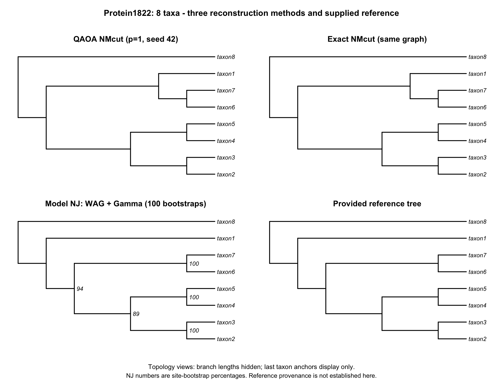

# QPhylo: protein phylogeny with QAOA normalized minimum cut

**This effort is supported by Qollab & IonQ**

QPhylo is an eight-protein, reproducible pilot that asks whether a Qiskit QAOA
cut solver can follow Onodera-style constraint reinforcement and recursive
normalization, with a model-based neighbor-joining (NJ) comparison. It builds on
Fernández-Otero and colleagues' QAOA phylogeny work. It is an adaptation and
implementation study; it does not establish biological superiority or quantum
advantage. See [credits and starting materials](CREDITS.md).

## Run on Qollab

1. Use a **Python / Qiskit** project. Upload the contents of `qollab_upload/`
   to its project root: [main.py](qollab_upload/main.py),
   [LICENSE](qollab_upload/LICENSE), [CREDITS.md](qollab_upload/CREDITS.md),
   [README.md](qollab_upload/README.md), and its `assets/` folder.
   This upload README is the finished Qollab Project Card. Select
   `assets/project_banner_v2.png` as the separate project header image (D30).
   Replace the existing `main.py`. The code has a short copyright/SPDX header;
   full license text and upstream notices are in the separate documents.
2. Leave `RUN_MODE = 'auto'` near the top. No credentials, BLAST
   installation, or optional Qiskit Algorithms/Optimization packages are needed.
3. In Run Experiment, choose **Built-in simulator (24q)** for a fresh full tree.
   It uses the selected backend, p=1, 1,000 shots/circuit and SciPy COBYLA.
4. Choose an **IonQ simulator** to sample one eight-qubit root-cut circuit using
   angles trained in the saved ideal run. This mode submits one job; it performs
   no new angle optimization or full-tree reconstruction.

Other/unrecognized backends conservatively use the single-cut mode. Forcing
`full_tree` on such a backend fails before submitting a job. The selected backend
is never replaced by a statevector sampler.

The output labels **SAVED COMPARISON** separately from **CURRENT RUN**, prints a
readable tree or measured cut, and ends with an auditable `REPORT_JSON`. The
historical comparison is embedded; R/NJ is not rerun inside Qollab.

**Final entry validation:** both live paths passed and their saved outputs were
independently audited. Built-in full-tree mode completed 403 jobs with RF0 to
exact NMcut. IonQ Aria-1 noise mode completed one job, with 218 feasible and 27
optimal-cut shots out of 1,000; the best observed cut had gap 0. See the
[validation summary](results/submission_validation/summary.md) and
[repeat-check instructions](docs/QOLLAB_FINAL_CHECK.md).

## What is being tested?

```text
Aligned proteins -> ungapped BLASTP comparisons -> symmetric affinity graph
                                                 |
                       QAOA fixed-size cuts + local normalized-cut recursion
                                                 |
                         topology vs exact graph-cut recursion

Same supplied alignment -> WAG+Gamma distances -> NJ + site bootstrap
                                                 |
                              compare unrooted topology splits
```

At each recursive node, each size c=1..floor(n/2) is solved separately. The QUBO
is `cut(x) + alpha*(sum(x)-c)^2`. A lowest-energy observed sample with the wrong
size triggers a bounded penalty increase, 100 to 600. Among accepted feasible
samples, actual cut weight selects the candidate. Normalized cut uses degrees
in the **current induced graph**, then recursion continues until pairs/singletons.
Failed samples are not projected or replaced by an exact partition.

This is fixed-size minimum-cut recursion followed by normalized-cut comparison;
the exact reference is not a global exact normalized-cut optimizer. The displayed
root records recursion, not an inferred evolutionary root. Branch lengths are
not estimated by the graph-cut method.

BLASTP bit scores are divided by the mean positive self-score and multiplied by
100. Both directed normalized scores are averaged, with a missing direction
contributing zero; the graph diagonal is zero. These explicit conventions and
the one-retry limit are adaptations, not a complete reproduction of Onodera.

## Results available now

| Pilot | Observed result | Interpretation |
| --- | --- | --- |
| Synthetic eight taxa, five paired initialization seeds | All ten coordinate/COBYLA trees: RF=0 to exact; mean jobs 254.2/203.8 | Both worked on this small fixture; no general optimizer superiority established |
| Eight proteins, one ideal QAOA run | 403 jobs, 403,000 shots, five penalty reinforcements; RF=0 to exact NMcut | Sampled solver reproduced the exact graph-cut topology on this run |
| Model NJ on the same 389-column alignment | NJ vs supplied reference RF=0; NMcut vs NJ RF=2, normalized 0.2 | One internal split differs; the discrepancy also exists with exact NMcut |

The different NJ split groups taxon1 with taxon8 and has 94% site-bootstrap
support. Bootstrap support measures resampling stability, not proof of truth.
The supplied reference's generating-tree provenance is unverified. One protein
seed, fixed simulator seeds, and ideal simulation do not establish robustness,
biological accuracy, hardware performance, or quantum advantage.



See [protein run summary](results/protein1822_cobyla_run1/summary.md),
[NJ comparison](results/protein1822_comparison/summary.md), and
[optimizer figure](results/eight_taxa_comparison/optimizer_comparison.png).
Raw Qollab outputs, counts, traces, CSV tables and hashes accompany these results.

## Reproduce and extend

[Reproduction instructions](docs/REPRODUCING.md) cover the local Conda environment,
preprocessing, output audits, NJ, packaging and tests. Core/scoring/audit code
uses standard Python; local BLAST/R and browser Qiskit are separate dependencies.

- `qphylo_core.py`: fixed-size reference, local normalization, recursion.
- `qphylo_qaoa.py`: Ising gates, selected-backend sampling, optimizers, reinforcement.
- `qphylo_proteins.py`: FASTA/BLASTP graph construction and provenance.
- `qphylo_nj.py` / `build_model_nj.R`: matched-input model NJ and bootstrap.
- `prepare_submission.py`: verifies saved inputs and builds the single-file entry.
- `collect_qaoa_results.py`: rescoring and export of saved tree reports.
- `tests/`: math, data and execution checks; mocked backend tests are identified.

Start an extension with a small connected protein graph, validate taxa/provenance,
and compare sampled cuts against exact fixed-size references before scaling.
Keep graph, shot budget and preprocessing fixed when comparing optimizers.
Controlled divergence/noise studies and additional protein seeds are future work.

Project code and original documentation are MIT-licensed; preserved third-party
notices and data provenance are in [CREDITS.md](CREDITS.md). The working folder's
fork and research PDFs are not intended as a wholesale submission. A curated
local copy can be built with `python prepare_release.py`; nothing is published
by that command. See [submission checklist](docs/SUBMISSION_CHECKLIST.md).
