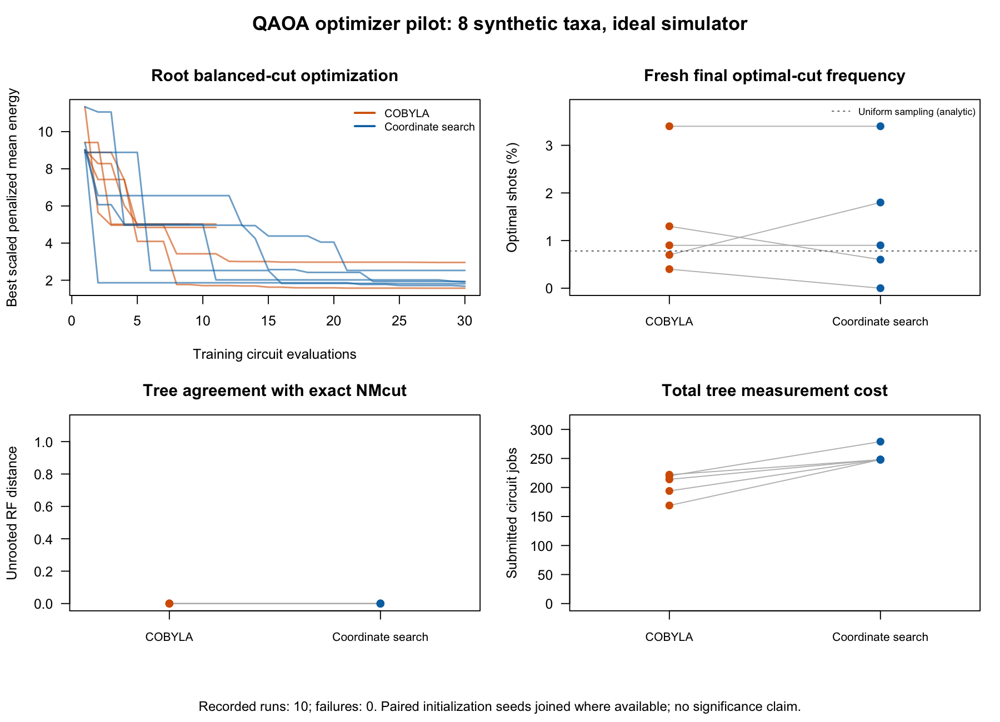

# QPhylo: protein phylogeny with QAOA normalized minimum cut

**This effort is supported by Qollab & IonQ**

Can a Qiskit QAOA cut solver reconstruct a protein tree while following
Onodera-style constraint reinforcement and recursive normalization? QPhylo is
an eight-protein pilot comparing the sampled quantum algorithm with exact
graph cuts and model-based neighbor joining (NJ).

**Our main finding:** QAOA recovered the exact graph-cut topology on this input.
Both graph-cut trees differed from NJ by one internal split. That separates a
difference between reconstruction methods from an error in the sampled cut solver.

## Run the project

Leave `RUN_MODE = 'auto'` near the top of [main.py](main.py), then select a
backend in **Run Experiment**:

| Backend | What this run does |
| --- | --- |
| **Built-in simulator (24q)** | Optimizes QAOA angles with COBYLA and reconstructs a fresh full protein tree. |
| **IonQ simulator** | Measures one eight-qubit root-cut circuit using angles trained in the saved ideal run. |

The entry contains the graph and audited historical comparison. No supporting
code or data files, local BLAST/R installation, credentials, or optional Qiskit
Algorithms/Optimization packages are needed. Other backends conservatively use
the single-cut path.

Look for **CURRENT RUN** to see the new tree or measured partition, job counts,
and comparison scores. **SAVED COMPARISON** is historical context. The final
`REPORT_JSON` retains counts and execution metadata for independent checking.
IonQ mode samples previously trained angles; it does not optimize or produce a
new full tree.

## From proteins to a tree

1. **Build affinities.** Read the supplied eight-protein alignment, remove gaps
   for BLASTP, normalize directed bit scores by self scores, and average the two
   directions to form a symmetric graph.
2. **Solve fixed-size cuts.** For each candidate partition size, a depth-one
   QAOA circuit samples a cut objective with a penalty for the wrong size.
   COBYLA adjusts its angles, using 1,000 shots per circuit.
3. **Reinforce and recurse.** A wrong-size lowest-energy observed sample triggers
   one allowed penalty increase, from 100 to 600. Accepted feasible cuts compete
   by normalized cut using degrees in the current induced graph. Recursion
   continues until pairs or singletons remain.
4. **Compare methods.** The same alignment supplies WAG+Gamma model distances for
   NJ, with 100 site bootstraps. Unrooted tree splits are compared with QAOA,
   exact graph-cut recursion, and the supplied reference.

Here, **exact NMcut** means enumerating every feasible fixed-size partition at
each recursive step, then applying the same normalized-cut selection and
recursion. It does not use an eigensolver, and it is not a globally optimal
phylogenetic tree. Exact solving is a diagnostic baseline; a failed measured
partition is never replaced by an exact answer.

## Protein pilot results

*The same eight proteins underlie every tree. Branch lengths are hidden; the
display anchor does not establish an evolutionary root. NJ labels show site
bootstrap percentages. The supplied reference's generating history is unverified.*

| Comparison or execution | Verified result |
| --- | --- |
| QAOA vs exact graph-cut recursion | Same unrooted topology: Robinson–Foulds distance (RF) = 0 |
| QAOA/exact vs model NJ | One different internal split: RF = 2, normalized RF = 0.2 |
| Model NJ vs supplied reference | RF = 0; reference provenance remains unresolved |
| Fresh built-in full-tree check | 403 completed jobs; five successful penalty reinforcements; RF = 0 to exact |
| IonQ Aria-1 noise-model check | One completed job; 218 feasible and 27 minimum-cut shots out of 1,000 |

NJ's taxon1/taxon8 split had **94% bootstrap support**. The QAOA/exact tree
instead grouped taxon1 with taxon6/taxon7 at that split. Because the discrepancy
persists under exact solving, it is not attributable to QAOA topology approximation
in this run.

The noisy IonQ check observed an exact minimum root cut at least once. Its 2.7%
optimal-cut frequency and 21.8% feasible frequency describe that one measurement;
they do not establish full-tree performance under noise. These are simulator
results, rather than quantum-hardware runs.

## Optimizer pilot

Five paired initialization seeds produced ten successful synthetic eight-taxon
runs. Every tree matched exact graph-cut topology. COBYLA used **203.8 mean
circuit jobs**, compared with **254.2** for coordinate search in this fixture.
The figure also shows training energy, final optimal-cut frequency and topology
agreement. This small pilot does not establish general optimizer superiority.

## Contribution and limits

QPhylo adapts Fernández-Otero and colleagues' QAOA phylogeny approach toward
Onodera-style reinforcement, local recursive normalization, and an explicit
model-based NJ comparison. Its contribution is a runnable, auditable Qiskit
workflow with protein affinity provenance and separate local/cloud execution
paths. The preprocessing conventions, retry limit and optimizer budget are
documented adaptations, rather than a complete reproduction of either paper.

The protein experiment uses one input and one initialization. The final ideal
check repeats that initialization, so it is not independent evidence of
reliability. No biological superiority, quantum advantage, hardware speedup or
large-scale performance is claimed. Further work would use more seeds and
controlled sequence datasets with verified generating trees, then compare depth
and noise under matched budgets.

To repeat the Qollab experiment, run the chosen mode and preserve the complete
output separately. The [QPhylo source repository](https://github.com/noamurphy/QPhylo)
contains reusable modules, tests, input provenance, raw reports and comparison tables.
Follow its [reproduction guide](https://github.com/noamurphy/QPhylo/blob/main/docs/REPRODUCING.md)
to repeat the local preprocessing, audits and model-based NJ comparison.

## Credit, starting materials and license

NMcut methodology: Onodera, Hara, Aoki, Asahi and Sawamura,
[2023 paper](https://doi.org/10.1016/j.ympev.2022.107636). Their Digital Annealer
was quantum-inspired. Prior QAOA phylogeny: Fernández-Otero, Pena and Pichel,
[2026 paper](https://doi.org/10.1007/s11227-026-08465-x) and
[PhyloTree_ReConst](https://github.com/Nicofero/PhyloTree_ReConst), which supplied
the selected alignment and reference tree. FO credits RAxMLGrove as its data source.

QAOA originates with Farhi, Goldstone and Gutmann. Qiskit, SciPy, BLAST+, R,
ape, phangorn and the Qollab tutorials support this implementation. Full
references, upstream notices and data-source terms are in [CREDITS.md](CREDITS.md).

The project began with earlier planning, an initial reference core and the
upstream fork. Hackathon additions used Codex assistance under Noah's direction;
this starting work and assistance are disclosed in the credits. Figures are
original plots of saved project results. The optional project header is
AI-generated conceptual protein/quantum artwork, separate from those results.
Original project software and
documentation use the [MIT License](LICENSE); third-party terms are preserved.
